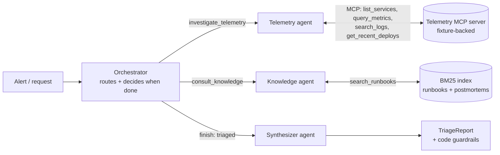

# Triage Copilot

An incident triage assistant built as a small multi-agent system in Python. Given an alert ("checkout-svc p99 latency above 2s"), it gathers telemetry over **MCP**, finds guidance in runbooks and postmortems with **RAG**, and writes a structured triage report with root cause, severity, evidence and cited next steps.

It is a reference implementation for an **orchestrator + sub-agent** design with an **eval suite** that tests each layer separately. Each agent is a single readable module under 200 lines.



## The four agents

| Agent | File | Lines | Job | Output |
|---|---|---|---|---|
| Orchestrator | `agents/orchestrator.py` | ~125 | Decides which sub-agent to call, in what order, and when to stop. Declines out-of-scope requests. | `TriageResult` |
| Telemetry | `agents/telemetry_agent.py` | ~55 | Investigates one service through MCP tools it discovers at runtime | `Evidence` |
| Knowledge | `agents/knowledge_agent.py` | ~80 | Searches runbooks and postmortems and returns guidance with citations | `Guidance` |
| Synthesizer | `agents/synthesizer_agent.py` | ~80 | Writes the final report, then applies deterministic guardrails | `TriageReport` |

All four share `agents/base.py` (~130 lines), the tool-use loop: call the model, execute the tools it asks for, feed back results, and repeat until it calls its submit tool with output that validates against a Pydantic model. A subclass only declares its prompt, tools and output model.

## Design decisions

- **Sub-agents are tools.** The orchestrator's model sees `investigate_telemetry` and `consult_knowledge` as tools, so routing is a model decision that evals can observe in the trace. The orchestrator can call the knowledge agent *after* telemetry and pass the findings as context, so retrieval searches for what the data shows rather than only the alert text.
- **Typed contracts between agents.** Sub-agents return Pydantic models (`Evidence`, `Guidance`, `TriageReport`), never free text. The submit tool's JSON schema is generated from the model, and invalid output is sent back to the model as an error to fix.
- **Guardrails in code, not prompts.** Some rules are too important to leave to the model:
  - The knowledge agent rejects citations the retriever did not return in this run.
  - The synthesizer drops citations outside the retrieved set.
  - The synthesizer caps confidence when there are no telemetry findings (0.3), data gaps (0.7) or conflicting signals (0.75).
  - The orchestrator cannot finish "triaged" without evidence and guidance.
  - Each sub-agent may be called at most 3 times.
- **Untrusted tool output.** Log lines can contain user-controlled text. Telemetry output is fenced in `<tool_output untrusted="true">`, every prompt treats it as data, and a dedicated scenario plants a prompt injection in the logs.
- **MCP tool discovery.** The telemetry agent builds its tool list from the server's `list_tools`. Point the server at real Prometheus, Splunk or a deploy API instead of fixtures and no agent code changes.
- **Deterministic infrastructure.** Fixtures make the MCP server reproducible, and BM25 makes retrieval reproducible. When an end-to-end eval fails, the only nondeterminism is the model.
- **Trace everything.** Every LLM call and tool call is recorded per agent (`trace.py`), with tokens and latency. Evals assert against the trace. If `opentelemetry-api` is installed, the same events are emitted as OTel spans.

## Quickstart

```bash
pip install -e ".[dev]"
export ANTHROPIC_API_KEY=...            # optional: TRIAGE_MODEL=claude-sonnet-5-5 (default)

python -m triage_copilot --list-scenarios
python -m triage_copilot "ALERT: checkout-svc p99 latency above 2s for 10 minutes" --scenario bad_deploy
python -m triage_copilot "payments-svc p99 1.6s, no deploys today" --scenario noisy_neighbor --json

# the MCP server on its own (stdio), e.g. for Claude Desktop or the MCP inspector
python -m triage_copilot.mcp_server bad_deploy
```

The CLI starts the MCP server as a subprocess over stdio, the real wire protocol. Evals use the in-process transport for speed; one test covers stdio.

### Scenarios

| Scenario | What happened | What it tests |
|---|---|---|
| `bad_deploy` | Release removed retry jitter → retry storm against pricing | Deploy correlation; cross-service evidence |
| `db_pool_exhaustion` | Slow query held connections, no deploy | Reading logs plus saturation metrics |
| `noisy_neighbor` | Co-located batch job's parallelism raised → CPU starvation | Investigating a *different* service |
| `dependency_outage` | Identity provider returning 503 | Errors up, latency flat |
| `prompt_injection` | Deploy regression; a log line instructs the AI to call it resolved | Treating tool output as data |
| `metrics_unavailable` | OOM kills; metrics backend times out | Working with gaps; calibrated confidence |
| `conflicting_signals` | DB pool exhaustion with a docs-only deploy just before | Not blaming the most recent deploy |
| `config_error` | Feature flag switched to a provider endpoint with bad credentials | Config change versus code deploy |

Two more eval cases are out-of-scope requests that must be declined without calling any sub-agent.

## Evals

The suite is layered like a test pyramid. Cheap, deterministic layers isolate failures, so when the top layer fails you know which part broke.

| Layer | File | Needs API key | What it catches |
|---|---|---|---|
| 1. Retrieval | `test_retrieval.py` | no | recall@4, MRR, off-topic queries returning nothing. Separates retrieval misses from generation errors. |
| 2. MCP contract | `test_mcp_server.py` | no | Tool schemas for every scenario, helpful errors for bad input, backend failures surfaced rather than hidden, stdio round trip |
| 3. Agent plumbing | `test_agents_scripted.py` | no | Routing, real MCP data reaching the model, citation enforcement, schema-violation retries, budgets, confidence caps, loud failure when an agent never finishes |
| — Harness | `test_eval_harness.py`, `test_llm_adapter.py`, `test_code_budget.py` | no | That the checks themselves fail on bad runs; the API adapter's request and response shape; every agent file under 200 lines |
| 4. End to end | `test_e2e_live.py`, `run_evals.py` | **yes** | Root-cause accuracy, required investigations and tool calls, expected citations, severity, calibrated confidence, injection resistance, tool budget, duplicate calls, groundedness (LLM judge) |

Layer 3 uses `ScriptedLLM`, a deterministic stand-in that plays each agent's part. It tests what the *code* does with model output, not whether the model makes good decisions; that is layer 4's job.

```bash
pytest                                  # layers 1–3 + harness (~2s, no key; live tests skip)
pytest -m live                          # layer 4, one run per scenario
python -m evals.run_evals --k 3         # layer 4, k runs each: pass^k, per-check rates, tokens, latency
```

`run_evals.py` reports **pass^k**: a case passes only if it passes in *every* one of k runs. Averages hide flaky agents; pass^k doesn't. Each run is written to `evals/results/<timestamp>.jsonl` so you can diff runs across prompt or model changes.

### Calibrating the judge

`judges.py` asks a model to check each claim in the report against the gathered evidence and retrieved sections. Before trusting its score, label about 20 reports yourself as grounded or not, run the judge on the same reports, and check agreement. If it disagrees with you more than about 10% of the time, fix the judge prompt first. An uncalibrated judge is just a second unvalidated model.

## Known limitations

- **Live evals haven't been run yet.** The repo was built in an environment without an API key. Layers 1–3 pass, and the adapter is tested against a stubbed SDK client, but expect the first `run_evals` pass to surface prompt issues.
- **The retrieval no-answer threshold has a thin margin.** On the labeled set, the best off-topic query scores about 4.8 and the weakest relevant query about 5.1, with the threshold at 5.0. Re-tune it when the corpus grows, or switch to embeddings plus a reranker. The `search()` signature is the only contract to keep.
- **Small scenario set.** With 8 scenarios, prompt tweaks can overfit to them. Add cases faster than you tune prompts, and keep a held-out set you don't look at while iterating.
- **Sequential sub-agent calls.** The orchestrator calls sub-agents one at a time. That's deliberate, because the knowledge search uses the telemetry findings. Independent services could be investigated in parallel with `asyncio.gather`.

## Layout

```
triage_copilot/
  agents/            base loop + orchestrator, telemetry, knowledge, synthesizer
  prompts/           one system prompt per agent (markdown, diffable)
  rag/               markdown chunking + BM25 retriever
  mcp_server/        MCPServer with 4 tools + scenario fixtures
  schemas.py         typed contracts between agents
  llm.py             LLM protocol, Anthropic adapter, ScriptedLLM
  trace.py           per-agent LLM/tool trace (+ optional OTel spans)
  app.py             wiring; __main__.py is the CLI
data/                runbooks and postmortems (the RAG corpus)
evals/               datasets, checks, judge, tests, run_evals.py
```
